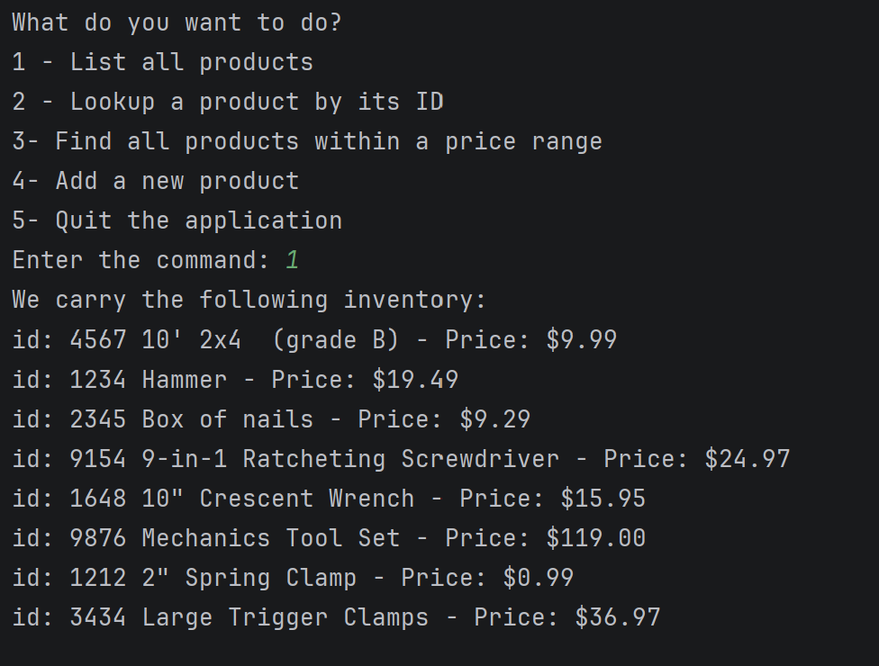

# Search Inventory

A app for a store that loads its product inventory from a file
and lets you browse it from a menu.

## Features

- Loads every product from `inventory.csv` (id, name, and price)
- Menu that keeps running until you choose to quit
- List all products with their prices

## How to run it

1. Open the project in IntelliJ 
2. Run `StoreApp.java`
3. Type a number from the menu, like `1` to list all products

Each line in `inventory.csv` looks like this:

```
1234|Hammer|19.49
```

## Interesting code

This loop reads the file one line at a time. It splits each line at the `|`,
turns the pieces into an id, a name, and a price, and adds a new `Product`
to the list. Because it loops until the end of the file, it works with
however many products are in `inventory.csv`.

```java
while ((input = bufReader.readLine()) != null) {
    String[] tokens = input.split("\\|");

    int id = Integer.parseInt(tokens[0]);
    String name = tokens[1];
    double price = Double.parseDouble(tokens[2]);

    inventory.add(new Product(id, name, price));
}
```

## Screenshots

